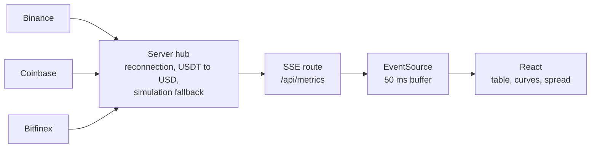

# Herimalala Ranaivoarisoa — Portfolio

[](https://github.com/aiaa4solutions-debug/portfolio/actions/workflows/ci.yml)

Personal portfolio of a full stack developer working with JavaScript, TypeScript and
Python: modern web applications, workflow automation and AI integration.

Built with Next.js 15 (App Router), TypeScript, Tailwind CSS, shadcn/ui, Framer Motion
and next-themes.

## Featured project: real-time BTC feed

The portfolio includes a live demo at `/projects/btc-realtime`: Bitcoin trades from
Binance, Coinbase and Bitfinex, compared in real time.

- **Shared server hub**: one WebSocket connection per exchange for all visitors, with
  automatic reconnection (exponential backoff and jitter).
- **SSE route** `/api/metrics`: backpressure, keep-alive and per-second statistics.
- **Table, curves and spread views**: six curves (buy and sell per exchange), a window of
  30 seconds, 2 minutes or 10 minutes, pause, CSV export and a keyboard-accessible tooltip.
- **Spread between exchanges**: Binance prices (USDT) are converted to USD with the
  USDT/USD rate read from Coinbase.
- **Resilience on display**: per-exchange status, latency, reconnects and dropped
  messages, an automatic fallback to simulated data when the exchanges are unreachable,
  and a button that simulates a client-side outage.



| Choice | Reason |
| --- | --- |
| SSE instead of a browser WebSocket | The feed is one-way, and `EventSource` reconnects natively. |
| One shared connection per exchange | Without it, upstream connections grow with the audience. |
| 50 ms client buffer | Dozens of messages per second, but a single React render per batch. |
| One curve point every 500 ms, last price carried forward | The six lines stay continuous despite very different event rates. |
| Backpressure | A slow client loses trades (they are counted) instead of filling server memory. |
| Trade side read from the aggressor | Binance `m = true` is a sell; Coinbase `side` is the **maker** side, so it is inverted; Bitfinex uses the sign of the amount. |

The code lives in `lib/market` (parsers, analytics, hub, simulator),
`components/market` (dashboard, chart, hook) and `app/api/metrics/route.ts`.

## Stack

- **Next.js 15**: App Router, `next/font`, metadata API, route handlers
- **TypeScript**: strict mode
- **Tailwind CSS 3**: custom Slate / Indigo / Cyan design tokens
- **shadcn/ui**: Button, Card, Badge, Separator primitives
- **Framer Motion**: scroll and load animations
- **Recharts 3**: live charts for the BTC demo
- **lucide-react**: icons
- **next-themes**: dark/light mode with system preference
- **Vitest and Playwright**: unit and end-to-end tests

## Getting started

Requirements: Node.js 22 (LTS) and npm.

```bash
npm install
npm run dev
```

Open [http://localhost:3000](http://localhost:3000). The BTC demo is at
[http://localhost:3000/projects/btc-realtime](http://localhost:3000/projects/btc-realtime).

### Scripts

| Script | Purpose |
| --- | --- |
| `npm run dev` | Development server |
| `npm run build` / `npm run start` | Production build and server |
| `npm run lint` | ESLint (`next/core-web-vitals`) |
| `npm run typecheck` | TypeScript, no emit |
| `npm run test:unit` | Vitest: parsers, analytics, hub |
| `npm run test:e2e` | Playwright, in simulation mode (no network needed) |

Before the first end-to-end run, install the browser once with
`npx playwright install chromium`.

### Environment variables

All variables are optional.

| Variable | Purpose |
| --- | --- |
| `MARKET_MODE` | `auto` (default): live data with a fallback to simulation after 10 s of silence. `live`: live data only. `replay`: simulated data only. |
| `BINANCE_WS_URL` | Alternative Binance WebSocket endpoint, for regions where the default one is blocked. |

## Project structure

```
app/
  layout.tsx            Root layout, fonts, SEO metadata, JSON-LD
  page.tsx              Home page, composes all sections
  globals.css           Design tokens (light + dark)
  sitemap.ts / robots.ts
  api/metrics/          SSE route for the BTC demo
  projects/btc-realtime/  Demo page, case study and Open Graph image
components/
  navbar.tsx, footer.tsx, theme-toggle.tsx, theme-provider.tsx
  sections/             Hero, About, Skills, Experience, Projects, Technologies, Contact
  market/               BTC dashboard, live chart, stream hook, architecture diagram
  ui/                   shadcn-style primitives (Button, Card, Badge, Separator)
data/
  experience.ts, projects.ts, skills.ts   Content, kept separate from markup
lib/
  utils.ts              `cn` class-merging helper
  market/               Parsers, analytics, server hub, simulator and their tests
e2e/                    Playwright tests
.github/workflows/      CI: lint, typecheck, unit and end-to-end tests
```

## Editing content

All copy for skills, experience and projects lives in `data/*.ts`. Update those files
rather than the components to change content. A project with an `href` becomes a link to
its page and shows a "Live demo" badge; `featured: true` makes its card full width.

## Testing and CI

GitHub Actions runs on every push to `main` and on every pull request: lint, type
check, unit tests, then the Playwright suite against a production build. The workflow sets
`MARKET_MODE=replay`, so the results never depend on the exchanges being reachable.

## Deployment

Ready to deploy on [Vercel](https://vercel.com): push to a Git repository and import the
project, or run `vercel` from the project root.

Before going live, update the `SITE_URL` constant in `app/layout.tsx`, the `SITE_URL`
constant in `app/sitemap.ts` and the URL in `app/robots.ts` to match the production domain.

Notes on the BTC demo in production:

- The hub lives in the server process, so each serverless instance has its own hub and
  each SSE connection is capped by `maxDuration` (60 seconds in the route). The browser
  reconnects on its own. For a large audience, move the hub to a small long-running Node
  service and keep the route as a relay.
- Some exchanges refuse connections from some countries, including from some hosting
  regions. Choose a function region that is not restricted, or set `BINANCE_WS_URL`. When
  no exchange answers, `auto` mode switches to clearly labeled simulated data.
- The data is public and shown for technical demonstration only. It is not financial
  advice, and the spread ignores fees and order book depth.
